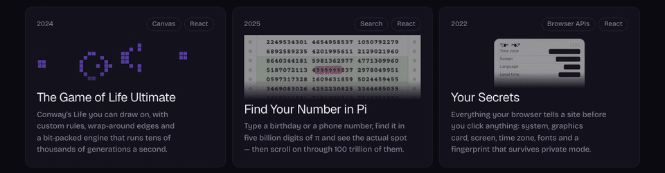
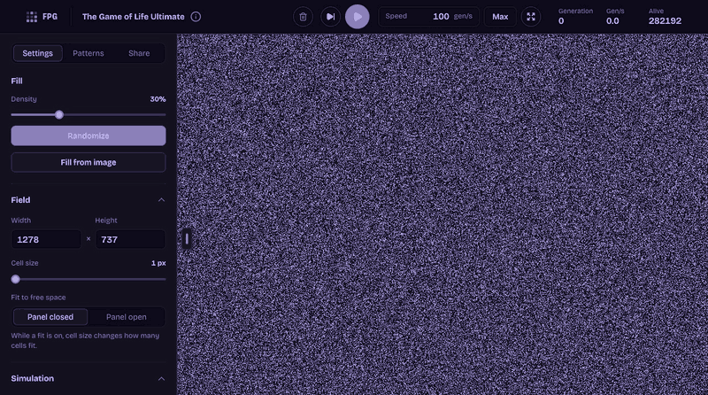
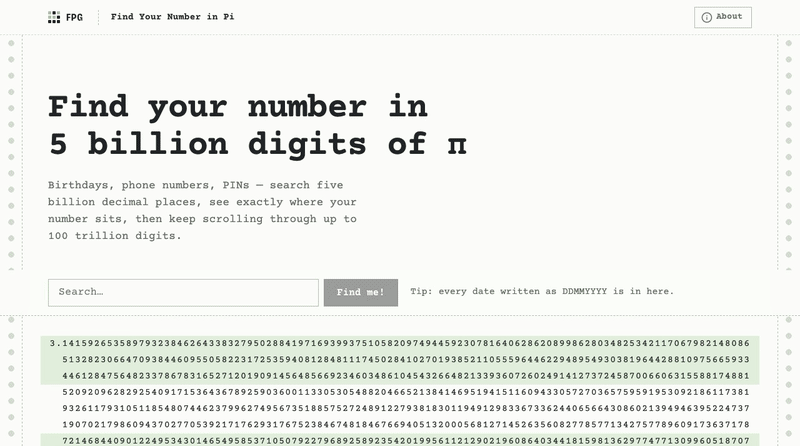

<div align="center">

<a href="https://frontend-play-ground.vercel.app"></a>

# Frontend Play Ground

**Small web experiments, each with a look of its own.**<br>
A place to learn new tech, build animations and small projects, and make things just for the fun of it.

[Live site](https://frontend-play-ground.vercel.app) · [The Game of Life Ultimate](#the-game-of-life-ultimate) · [Find Your Number in Pi](#find-your-number-in-pi) · [Your Secrets](#your-secrets)

</div>

## The Game of Life Ultimate

<a href="https://frontend-play-ground.vercel.app/the-game-of-life-ultimate"></a>

Conway’s Life you can draw on, with custom rules, wrap-around edges and a bit-packed engine that runs tens of thousands of generations a second.

- **Three engines behind one switch.** A 2D array, a 1D array, or a bit array that packs 32 cells into one number and steps them all with bitwise math: about 78× faster than the 2D array.
- **A live performance panel** that says what limits the speed right now: the simulation, the paint or the speed you set.
- **Any rules.** Life, HighLife, Seeds, Day & Night, Maze and more, or your own B/S rule.
- **Patterns and pictures.** A pattern library, any LifeWiki pattern pasted as RLE, or a photo dithered into cells. Fading trails show where life just was.
- **Share** a board as a link, a file or RLE.

**[Open it →](https://frontend-play-ground.vercel.app/the-game-of-life-ultimate)**

## Find Your Number in Pi

<a href="https://frontend-play-ground.vercel.app/find-number-in-pi"></a>

Type a birthday or a phone number, find it in five billion digits of π and see the actual spot — then scroll on through 100 trillion of them.

- **A place, not just a position.** Your number lights up inside the real digits, with everything before and after it laid out around it.
- **Every occurrence.** Einstein’s birthday, 14031879, shows up 43 times; step from one to the next, or share a link to any of them.
- **Keep scrolling.** The viewer pages through up to 100 trillion digits for as long as you like.
- Every date written as DDMMYYYY is in there.

Searches and occurrence counts come from [PiSearch](https://pisearch.joshkeegan.co.uk/) by Josh Keegan (five billion digits); every digit past the first five million comes from [pi.delivery](https://pi.delivery/) by Emma Haruka Iwao and Google Cloud (100 trillion).

**[Open it →](https://frontend-play-ground.vercel.app/find-number-in-pi)**

## Your Secrets

<a href="https://frontend-play-ground.vercel.app/your-secrets"></a>

<sub>Recorded with a sample IP address.</sub>

Everything your browser tells a site before you click anything: system, graphics card, screen, time zone, fonts and a fingerprint that survives private mode.

- **The file on you.** A one-line summary, conclusions ranked worst last, and a score out of 100 for how easy you are to track.
- **A fingerprint without cookies.** Canvas, audio and graphics hashes add up to an ID that stays the same in a private window.
- **Card by card.** Time zone, graphics card, fonts, codecs, voices, extensions, what the server sees, and on each card how the page knows it.
- **Nothing leaves the tab.** It all runs in your browser. The one exception is the IP lookup on the site’s own server, which stores nothing. Whatever needs a permission waits for your click.

**[Open it →](https://frontend-play-ground.vercel.app/your-secrets)**

## Also on the site

- **[motionrig](https://github.com/DpAkyJ1A/motionrig)** — devs rig it, designers play it: a 3 kB panel to tune durations, curves and distances on the live site, then send the values back to code.
- **[Fadey](https://fadey.vercel.app)** — notes that burn after reading: write one, share the link, and it’s gone after the first read, a timer or a set number of views.

## Development

### Stack

Next.js (App Router) · React · TypeScript · CSS Modules · lucide-react · MediaPipe Tasks Vision · pnpm. Deployed on Vercel.

### Analytics

Vercel Web Analytics (page views) and Speed Insights (Core Web Vitals from real visits), both in `src/components/Analytics`. Turn both on in the Vercel project's dashboard. URLs go out without the query and the hash, so searched numbers and shared boards stay in the browser.

### Scripts

```bash
pnpm install          # also copies the MediaPipe WASM runtime into public/mediapipe
pnpm dev              # http://localhost:3000
pnpm build && pnpm start
pnpm typecheck        # tsc --noEmit
pnpm lint             # eslint .
pnpm check            # typecheck + lint + build
```

### Configuration

| Variable | Default | What it does |
|---|---|---|
| `NEXT_PUBLIC_SITE_URL` | Vercel production URL, else `https://frontend-play-ground.vercel.app` | Canonical origin for metadata, Open Graph, JSON-LD, sitemap and robots |
| `NEXT_PUBLIC_BASE_PATH` | empty | Path prefix for hosting under a sub-path (e.g. `/frontend-play-ground`) |
| `STATIC_EXPORT` | unset | `1` builds a static export into `out/` for a static host |

A full static copy for GitHub Pages (instead of the redirect below):

```bash
STATIC_EXPORT=1 NEXT_PUBLIC_BASE_PATH=/frontend-play-ground NEXT_PUBLIC_SITE_URL=https://dpakyj1a.github.io pnpm build
touch out/.nojekyll   # Jekyll would drop the _next/ folder
pnpm dlx gh-pages@6.3.0 -d out --dotfiles
```

GitHub Pages serves the extensionless Open Graph images as `application/octet-stream`, so some link previews may skip them there; Vercel serves them as PNG.

### Old GitHub Pages address

The site used to live at `https://dpakyj1a.github.io/frontend-play-ground/`. `pnpm redirect:github-pages [new-origin]` builds a small redirect site that forwards every old URL (path, query and hash) to the new host; publish it with `pnpm dlx gh-pages@6.3.0 -d .github-pages-redirect --dotfiles`.
